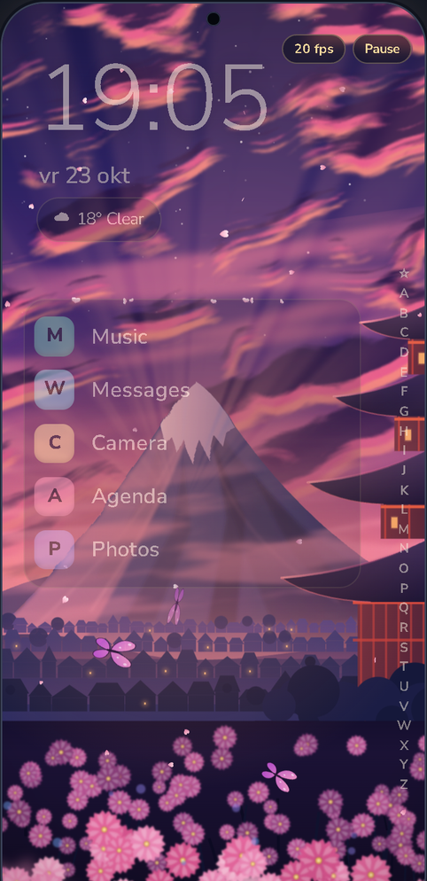
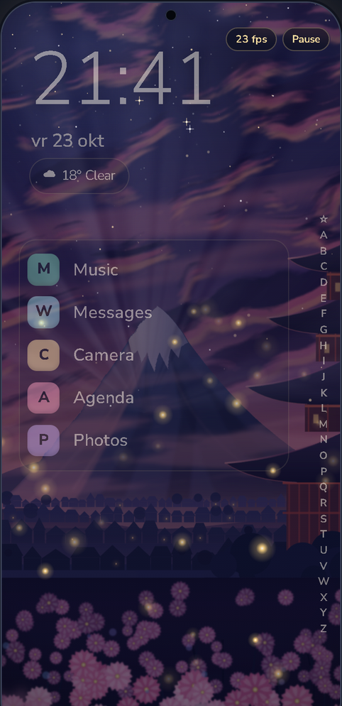
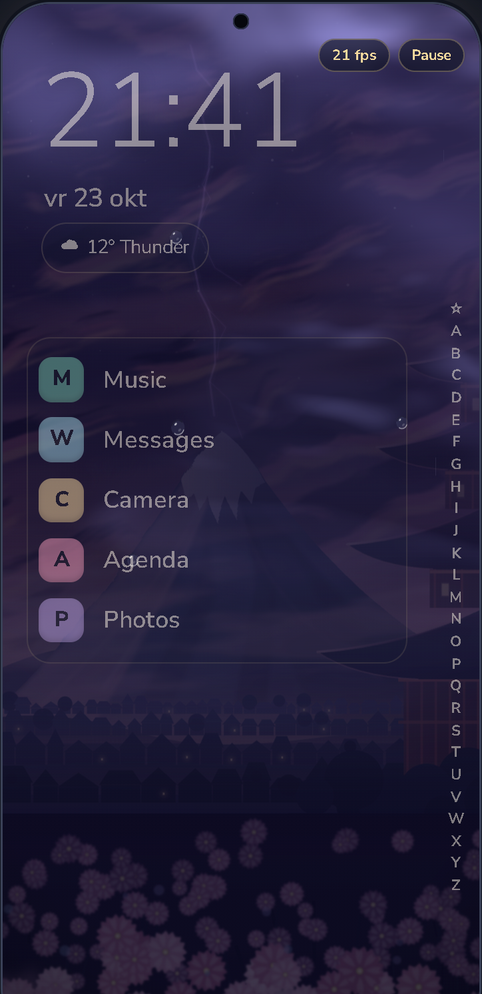

# Launcher (Seelie)

An Android home-screen launcher with a living, Genshin-inspired look: an A-Z app list with a letter rail, live wallpapers, a night screen, a PIN vault and a lot of ways to arrange your home screen. The app is called **Seelie**.

Unofficial fan-made project, not affiliated with or endorsed by HoYoverse.

| Sunset | Night | Storm |
| --- | --- | --- |
|  |  |  |

These pictures come from the **design prototype** (an HTML mock-up with made-up apps), not from the Kotlin app running on a phone. I did not have a clean emulator screenshot to use, and a real phone screenshot would show a real status bar, notifications and apps.

## Features

- Home screen styles (poster, wheel and more), clock faces, a glance line with weather and your next calendar event, and a widget stack.
- A-Z app list with a letter rail in several shapes (arc, fan, glider, lantern, wheel, constellation), favourites, icon packs and per-app tweaks.
- Live backgrounds drawn in code (sprites and a shader) plus 28 licence-checked wallpapers, credited in [CREDITS.md](CREDITS.md).
- Search for apps and contacts, with a calculator, quick notes and commands such as `> timer 5m` and `> alarm 7:30`.
- A night screen (also usable as Android's screen saver) and a music card with now-playing controls.
- PIN vault: hide apps behind a PIN or fingerprint, and lock apps everywhere. It hides apps inside Seelie only; it is not a safe for data.
- Saved looks, gestures, a volume side bar and quick toggles.
- Built with Kotlin and Jetpack Compose.

## Requirements

- Android 8.0 (API 26) or newer on the phone.
- [Android Studio](https://developer.android.com/studio) with the Android SDK that matches `compileSdk` in `app/build.gradle.kts` (currently 37), and JDK 11 or newer (Android Studio brings its own).

## How to build and run

1. Clone the repository and open the folder in Android Studio. It creates `local.properties` (your SDK path) for you; that file is ignored by git.
2. Let Gradle sync, connect a phone with USB debugging on (or start an emulator), and press Run.
3. Or from a terminal: `gradlew.bat assembleDebug` (Windows) or `./gradlew assembleDebug`, then install `app/build/outputs/apk/debug/app-debug.apk`.
4. Press the Home button and choose Seelie as the default home app. The app asks for permissions only when you switch the matching feature on.

The release build is signed with the debug key so it installs over debug builds. Make your own signing key before you share an APK. Keystores (`*.jks`, `*.keystore`) are ignored by git.

## Privacy and safety

- No account, no ads, no analytics. Settings, the vault and notes stay on the phone.
- The only network use is the weather line: if you allow location, Seelie sends a **rounded** position (about 10 km) to [Open-Meteo](https://open-meteo.com). Without location it uses the weather city you pick. Search opens your browser or Play Store only when you run a search.
- Permissions, each tied to one feature: calendar (next event), coarse location (weather), contacts (contact search, asked only when you tap "allow access"), notification access (music card and notification rows), biometrics (vault), set alarm (search commands), and two accessibility services (volume side bar buttons, and the app lock, which only learns which app comes to the front, never what is on screen).
- The vault PIN is never stored, only a salted PBKDF2 hash.

## Credits and licences

MIT, see [LICENSE](LICENSE). Wallpaper credits are in [CREDITS.md](CREDITS.md) (some are CC BY 4.0 and need the credit kept visible); icons, fonts and libraries are in [NOTICE.md](NOTICE.md) and [FONTS.md](FONTS.md).

More projects: https://github.com/Shamilimanuel
